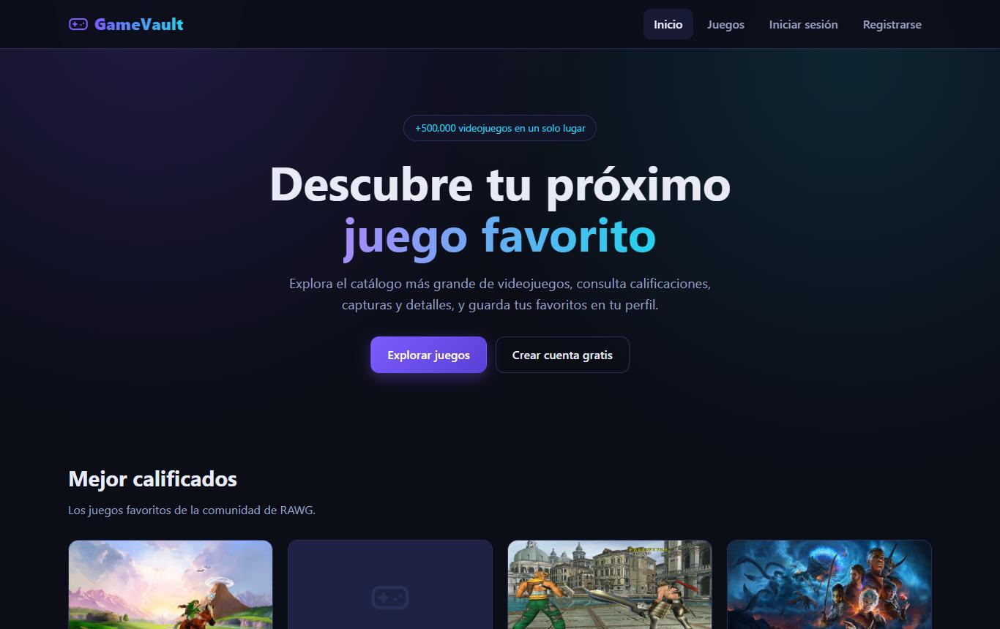
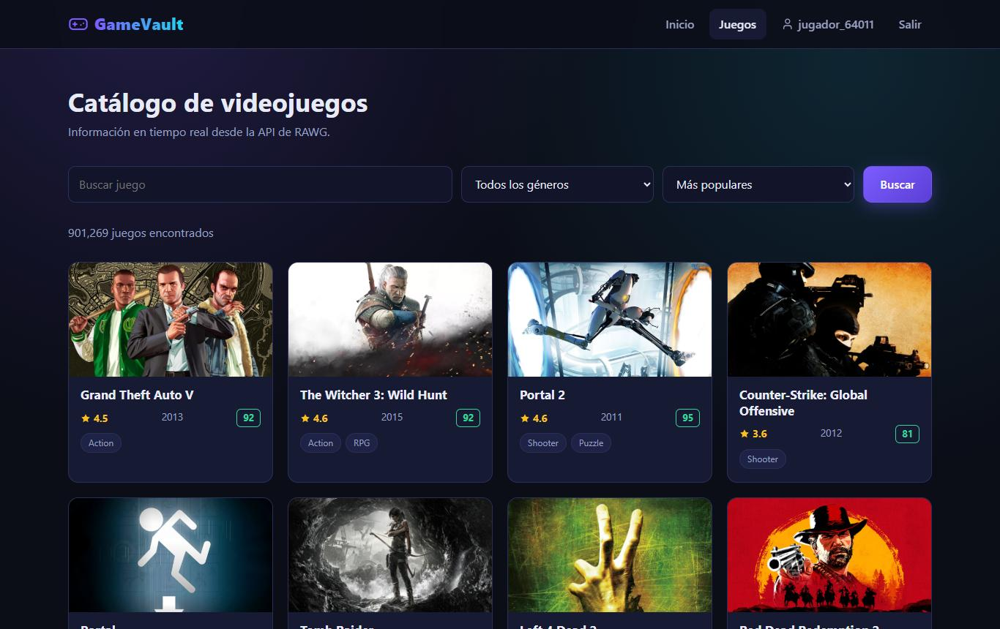
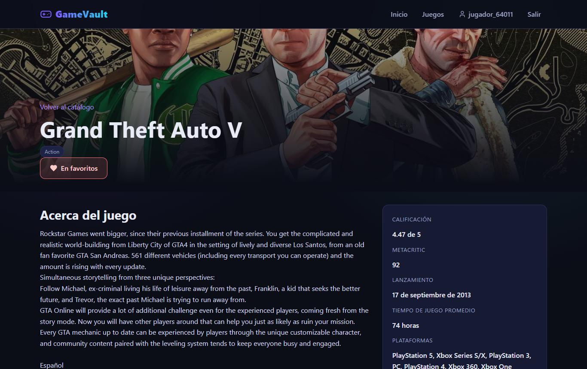
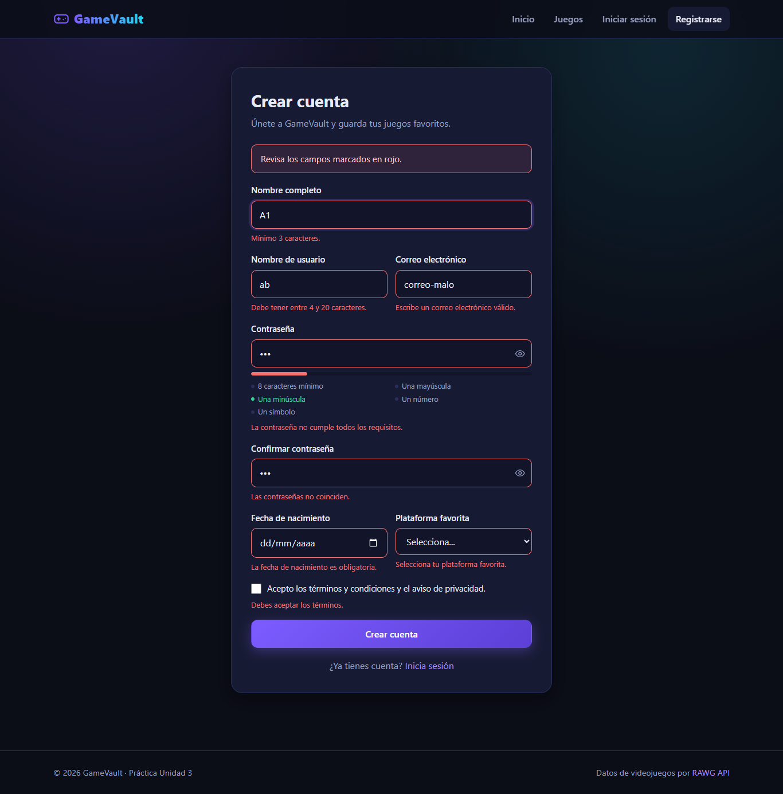
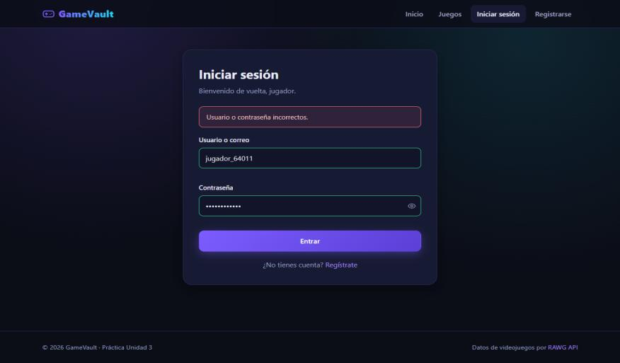
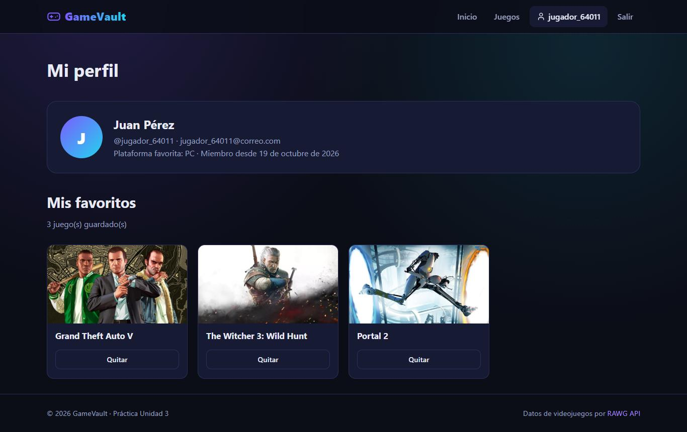
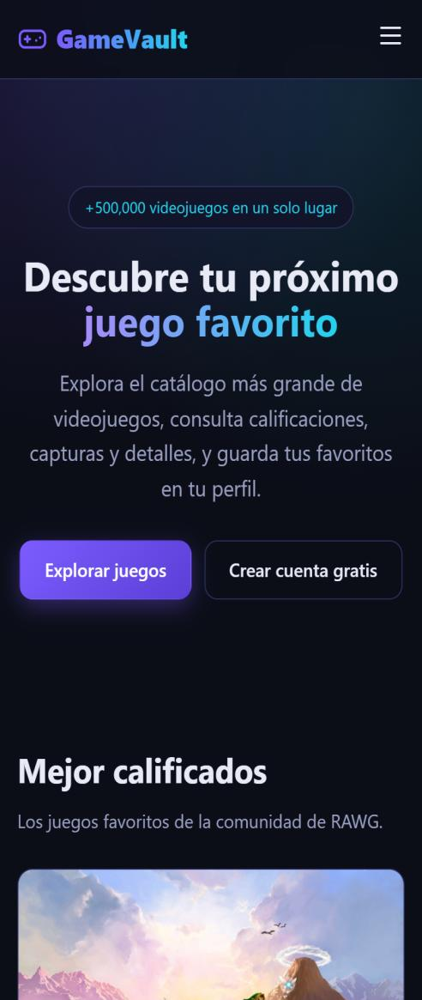
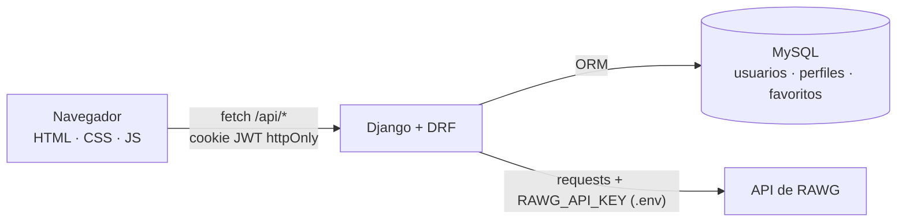

<div align="center">

# 🎮 GameVault

**Descubre, explora y guarda tus videojuegos favoritos.**

Catálogo de más de 900,000 videojuegos en tiempo real con la API de RAWG, cuentas de usuario seguras y lista de favoritos.




*Práctica 3 · Unidad 3: Seguridad, Web Services y APIs*
*Desarrollo Web Integral · IDGS 9-2 · Universidad Tecnológica de San Luis Río Colorado*

</div>

---

## 📑 Contenido

- [Características](#-características)
- [Capturas](#-capturas)
- [Arquitectura](#-arquitectura)
- [API REST](#-api-rest)
- [Seguridad](#-seguridad)
- [Patrones de diseño](#-patrones-de-diseño)
- [Instalación](#-instalación)
- [Pruebas](#-pruebas)
- [Estructura del proyecto](#-estructura-del-proyecto)
- [Autor](#-autor)

---

## ✨ Características

| Pantalla | Ruta | Descripción |
|---|---|---|
| 🏠 Inicio | `/` | Portada con los 8 juegos mejor calificados en Metacritic |
| 📝 Registro | `/registro` | Formulario con validación en tiempo real (cliente) y en el servidor |
| 🔑 Iniciar sesión | `/login` | Acceso con usuario **o** correo |
| 🕹️ Catálogo | `/juegos` | Búsqueda, filtro por género, orden y paginación |
| 📄 Detalle | `/juego?id=...` | Descripción, rating, plataformas, desarrollador, capturas y favoritos |
| 👤 Mi perfil | `/perfil` | Ruta protegida: datos del usuario y sus juegos favoritos |
| 📱 Responsive | — | El diseño se adapta al celular y el menú se vuelve un botón |

## 📸 Capturas

<table>
  <tr>
    <td align="center"><b>Catálogo</b><br></td>
    <td align="center"><b>Detalle del juego</b><br></td>
  </tr>
  <tr>
    <td align="center"><b>Registro con validación</b><br></td>
    <td align="center"><b>Iniciar sesión</b><br></td>
  </tr>
  <tr>
    <td align="center"><b>Mi perfil y favoritos</b><br></td>
    <td align="center"><b>Vista en celular</b><br></td>
  </tr>
</table>

## 🏗️ Arquitectura



- **Frontend** (`public/`): HTML, CSS y JavaScript sin frameworks. Se comunica solo con el backend propio.
- **Backend** (Django + Django REST Framework): expone el web service, guarda usuarios y favoritos en MySQL y funciona como **proxy** hacia RAWG, de modo que la clave de la API nunca llega al navegador.

## 🔌 API REST

| Método | Endpoint | Descripción | 🔒 Sesión |
|---|---|---|:---:|
| `POST` | `/api/registro` | Crear cuenta | |
| `POST` | `/api/login` | Iniciar sesión (usuario o correo) | |
| `POST` | `/api/logout` | Cerrar sesión | |
| `GET` | `/api/me` | Datos del usuario actual y sus favoritos | ✅ |
| `POST` | `/api/favoritos` | Agregar un favorito | ✅ |
| `DELETE` | `/api/favoritos/<id>` | Quitar un favorito | ✅ |
| `GET` | `/api/juegos?busqueda=&genero=&orden=&pagina=` | Buscar juegos (proxy a RAWG) | |
| `GET` | `/api/juegos/<id>` | Detalle de un juego | |
| `GET` | `/api/generos` | Lista de géneros | |

Todas las respuestas son JSON y usan los códigos HTTP correctos: `200`, `201`, `400`, `401`, `404`, `409`, `429`, `502` y `503`.

<details>
<summary>Ejemplo: registro</summary>

```http
POST /api/registro
Content-Type: application/json

{
  "nombre": "Juan Pérez",
  "usuario": "jugador_64011",
  "email": "jugador_64011@correo.com",
  "password": "Gamer#2026x",
  "confirmar": "Gamer#2026x",
  "nacimiento": "2003-04-15",
  "plataforma": "PC",
  "terminos": true
}
```

```http
HTTP/1.1 201 Created
Set-Cookie: token=<jwt>; HttpOnly; Max-Age=7200; SameSite=Strict

{ "mensaje": "Cuenta creada correctamente.", "usuario": { "id": 1, "usuario": "jugador_64011", ... } }
```
</details>

## 🛡️ Seguridad

| Medida | Cómo se implementa |
|---|---|
| **Secretos fuera del código** | Las claves van en `.env` (ignorado por Git) y se leen con `python-dotenv`. Se incluye `.env.example` como plantilla. |
| **Clave de la API oculta** | El navegador llama a `/api/juegos` y el servidor agrega la clave de RAWG (patrón *proxy*). |
| **Contraseñas cifradas** | Se usa el sistema de Django (PBKDF2-SHA256 con sal). Nunca se guardan ni se envían en texto plano. |
| **Sesión con JWT** | SimpleJWT. El token va en una cookie `httpOnly` (protege contra XSS) con `SameSite=Strict` (protege contra CSRF) y expira en 2 horas. |
| **Validación doble** | En el navegador para la experiencia de usuario y en el servidor con serializers de DRF para la seguridad real. |
| **Contraseña segura** | 8+ caracteres, mayúscula, minúscula, número y símbolo, más los validadores de Django (contraseñas comunes, parecida al usuario). |
| **Rate limiting** | Throttling de DRF: 20 intentos de login/registro cada 15 minutos y 60 consultas por minuto a la API externa. |
| **Cabeceras seguras** | *Content Security Policy* nativa de Django 6, `X-Frame-Options: DENY`, `nosniff` y `Referrer-Policy`. |
| **Prevención de XSS** | El frontend inserta datos con `textContent`, nunca con `innerHTML`. |
| **Sin enumeración de usuarios** | Mensaje genérico "Usuario o contraseña incorrectos" y mismo tiempo de respuesta, exista o no la cuenta. |
| **Inyección SQL** | Todas las consultas pasan por el ORM de Django. |
| **Límites de entrada** | Cuerpo de petición máximo de 10 KB y parámetros validados antes de enviarlos a RAWG. |

## 🧩 Patrones de diseño

| Patrón | Dónde | Para qué |
|---|---|---|
| **Factory Method** | `Perfil.crear_usuario()` en `usuarios/models.py` | Crea el `User` de Django y su `Perfil` en una sola transacción. |
| **Facade** | `ClienteRAWG` en `juegos/services.py` | Oculta la URL, la clave, el timeout y los errores de RAWG; las vistas solo llaman `buscar_juegos()`, `detalle_juego()` y `generos()`. |
| **Adapter** | `adaptar_resumen()` y `adaptar_detalle()` | Traducen el JSON de RAWG al formato en español que usa el frontend. |

## 🚀 Instalación

**Requisitos:** Python 3.12+ y MySQL 8.

```bash
# 1. Clonar e instalar dependencias
git clone https://github.com/TheRoDoX09/gamevault.git
cd gamevault
python -m venv venv
venv\Scripts\activate          # Linux/Mac: source venv/bin/activate
pip install -r requirements.txt
```

```sql
-- 2. Crear la base de datos en MySQL
CREATE DATABASE gamevault CHARACTER SET utf8mb4;
```

3. Copia `.env.example` como `.env` y llena tus valores:

| Variable | Descripción |
|---|---|
| `DJANGO_SECRET_KEY` | Clave secreta de Django |
| `DEBUG` | `True` en desarrollo |
| `DB_NAME`, `DB_USER`, `DB_PASSWORD`, `DB_HOST`, `DB_PORT` | Conexión a MySQL |
| `RAWG_API_KEY` | Clave gratuita de [rawg.io/apidocs](https://rawg.io/apidocs) |
| `JWT_SECRET` | Cadena aleatoria de al menos 32 caracteres |

Para generar las claves aleatorias:

```bash
python -c "from django.core.management.utils import get_random_secret_key as g; print(g())"
python -c "import secrets; print(secrets.token_hex(48))"
```

```bash
# 4. Crear las tablas y arrancar
python manage.py migrate
python manage.py runserver
```

Abre **http://localhost:8000** 🎉

Si quieres ver usuarios y favoritos en el panel `/admin/`, crea un administrador con `python manage.py createsuperuser`.

> **Nota sobre MySQL 8.0:** Django 6.1 pide MySQL 8.4 o superior. Para seguir usando MySQL 8.0, el proyecto incluye el backend `gamevault/mysql`, que solo desactiva esa revisión de versión.

## 🧪 Pruebas

```bash
python manage.py test
```

Son 21 pruebas con `APIClient` que cubren el registro, el login, la sesión y el logout, el rate limiting, los favoritos, el proxy de RAWG (simulado con `unittest.mock`), las páginas y las cabeceras de seguridad.

## 📂 Estructura del proyecto

```
gamevault/
├── manage.py
├── requirements.txt
├── .env.example            # Plantilla de variables de entorno
├── gamevault/              # Configuración del proyecto Django
│   ├── settings.py         # Apps, MySQL, DRF, SimpleJWT, CSP y throttling
│   ├── urls.py             # Rutas de la API y del frontend
│   ├── excepciones.py      # Formato de errores {"error": "..."}
│   ├── throttling.py       # Rate limiting
│   └── mysql/              # Backend compatible con MySQL 8.0
├── usuarios/               # App: cuentas y sesión
│   ├── models.py           # Perfil (Factory Method)
│   ├── serializers.py      # Validación del registro
│   ├── authentication.py   # JWT en cookie httpOnly
│   ├── views.py · urls.py · admin.py · tests.py
├── juegos/                 # App: catálogo y favoritos
│   ├── models.py           # Favorito
│   ├── services.py         # ClienteRAWG (Facade + Adapter)
│   ├── serializers.py · views.py · urls.py · admin.py · tests.py
├── public/                 # Frontend
│   ├── *.html              # Pantallas
│   ├── css/styles.css
│   └── js/                 # Lógica de cada pantalla
└── docs/capturas/          # Imágenes del README
```

## 👤 Autor

**Rodolfo Adrián Herrera Sosa**
Ingeniería en Desarrollo y Gestión de Software · Grupo 9-2
Universidad Tecnológica de San Luis Río Colorado
Materia: Desarrollo Web Integral · Profesor: José Julián Reyes Patiño

---

<div align="center">
<sub>Datos de videojuegos proporcionados por <a href="https://rawg.io">RAWG</a>.</sub>
</div>
